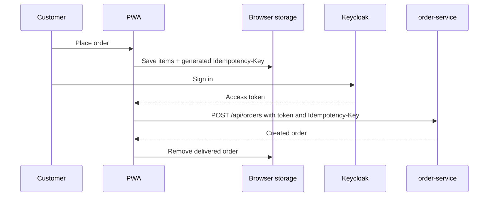

# SpareLink Frontend

[](https://github.com/tadiwanashe-mashongwa/sparelink-frontend/actions/workflows/ci.yml)

The customer-facing Progressive Web App for the SpareLink automotive spare-parts platform. It lets customers browse the live catalogue, search parts, build a cart, and safely queue orders when connectivity is unavailable.

## Features

- Browse and search active catalogue parts.
- Cache the catalogue and cart locally for unreliable connections.
- Sign in through Keycloak using authorization-code flow with PKCE.
- Queue orders in local storage and deliver them automatically after sign-in or when the browser reconnects.
- Use a stable `Idempotency-Key` for each queued order, so retries cannot create duplicate orders.
- Installable PWA with an offline service worker.

## Run locally

Start the SpareLink platform services first, including Keycloak, catalogue-service, and order-service:

```powershell
cd "C:\Users\Dom\Desktop\30 DAYS OF PROJECTS\SpareLink"
docker compose up -d
```

Then start the frontend:

```powershell
cd "C:\Users\Dom\Desktop\30 DAYS OF PROJECTS\SpareLink\sparelink-frontend"
npm ci --legacy-peer-deps
npm run dev
```

Open [http://localhost:5173](http://localhost:5173).

For the containerized app, open [http://localhost:3000](http://localhost:3000) after `docker compose up -d`.

## Configuration

The development server proxies requests as follows:

| Browser path | Target service |
| --- | --- |
| `/api/parts` | catalogue-service (`8081`) |
| `/api/orders` | order-service (`8083`) |

Keycloak defaults to `http://localhost:8080`, realm `sparelink`, client `sparelink-api`. Set `VITE_KEYCLOAK_URL` to use another Keycloak instance.

## Quality checks

```powershell
npm test
npm run build
```

The GitHub Actions workflow runs both checks on pushes and pull requests to `main`.

## Order delivery flow



If delivery fails, the queued order is retained and retried when the browser next comes online.
